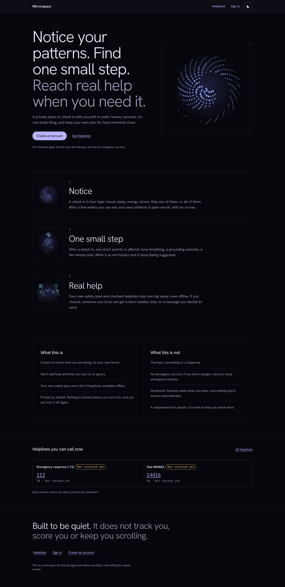
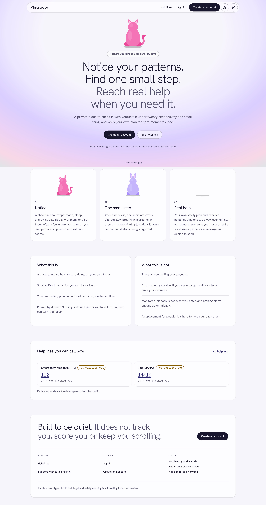
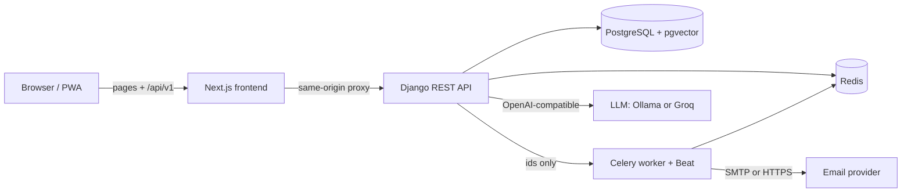

# Mirrorspace

[](https://github.com/sidzeeus/mirrorspace-wellbeing/actions/workflows/ci.yml)
[](LICENSE)

A privacy-first wellbeing companion for university students: daily check-ins, a place to vent, patterns over time, a personal safety plan, and Sushi, an AI companion you can talk or type to.

> **Not a medical device.** Mirrorspace is a support and education prototype. It does not diagnose, treat or monitor anyone, it never contacts anyone on its own, and nobody watches the data. If you are in danger, call your local emergency number.

| Night theme | Day theme |
|---|---|
|  |  |

## Why it exists

Students often notice they are struggling late, and many wellbeing apps either track too much or quietly share it. Mirrorspace is built the other way round:
- the student sees their own patterns;
- they can try a small self-help step;
- they reach trusted people or professional help only when they decide to.

Every kind of sharing is off by default, previewed, and revocable.

## Features

- **Check in** in four taps (mood, sleep, energy, stress). Sushi's face reacts to each answer.
- **Vent**: write freely and Sushi reacts to the feeling in your words. Nothing is kept unless you choose to keep it, and kept entries are encrypted.
- **Patterns**: two-week trends and gentle observations, never scores or streaks.
- **Episodes and triggers**: note hard moments and what helped.
- **Safety plan**: warning signs, coping steps and people to reach. It also works offline.
- **Sushi, the AI companion**: free conversation by text or voice, with speech recognition and a soft synthesised voice.
  - A deterministic, non-AI crisis check runs before and after the model.
  - Sushi suggests your own safety plan when you mention one of your triggers.
  - Sushi can see your check-ins and patterns only if you turn that on.
- **Trusted contacts and SOS**:
  - A contact must confirm by email before anything is sent (double opt-in).
  - SOS shows the exact recipient and message before sending.
  - The optional weekly email says only "checked in X of 7 days".
- **Sounds**: generated piano and rain for sleep, relaxing and anxious moments. Nothing is downloaded.
- **Accessible and installable**:
  - WCAG 2.2 AA, with keyboard and screen-reader support;
  - reduced-motion and low-data modes;
  - a PWA with an offline Support page;
  - every string translatable (next-intl).

## Tech stack

| Layer | Technology |
|---|---|
| Frontend | Next.js 16 (App Router), React 19, TypeScript (strict), Tailwind CSS 4, TanStack Query, Radix UI, React Hook Form + Zod, next-intl, Framer Motion, Web Speech and Web Audio APIs |
| Backend | Django 5.2, Django REST Framework, drf-spectacular (OpenAPI), Celery + Celery Beat |
| Data | PostgreSQL 16 + pgvector, Redis |
| AI | Any OpenAI-compatible endpoint: Ollama locally (Llama 3.1 8B), Groq for the hosted demo |
| Email | SMTP, or Brevo's HTTPS API, behind one adapter with a daily cap |
| Security | Session cookies + CSRF, Argon2 passwords, Fernet field encryption, per-route rate limits, redacted logs |
| Quality | pytest (850+ tests), Playwright + axe-core (78 browser tests), Ruff, mypy, ESLint |
| Delivery | Docker Compose, GitHub Actions (CI, image publishing), Render Blueprint |

## Architecture



The browser only ever talks to the frontend, which forwards `/api/v1` to Django. That keeps the session cookies first-party (`Secure`, `HttpOnly`, `SameSite=Lax`) with no cross-origin setup. Background tasks receive IDs only; message text is loaded inside the task, so it never sits in the queue or the logs.

How a chat message is handled:
1. A fixed crisis check runs in code. If it matches, the student sees a safety response, their plan and helplines, and the message never reaches the model.
2. The model answers with the conversation and, only if the student turned it on, a short summary of their own records.
3. The reply is checked again before it is shown.

## Run it locally

You need [Docker Desktop](https://www.docker.com/products/docker-desktop/). For the AI chat, also install [Ollama](https://ollama.com) and download the model once:

```bash
ollama pull llama3.1:8b
```

Then start the app:

```bash
git clone https://github.com/sidzeeus/mirrorspace-wellbeing.git
cd mirrorspace-wellbeing
docker compose up --build
```

| What | Where |
|---|---|
| App | http://localhost:3000 |
| Emails (local inbox, nothing is delivered) | http://localhost:8025 |
| API health | http://localhost:8000/api/v1/health |

It runs on the defaults in `.env.example`. To change anything, for example to send real email through Gmail, copy it to `.env` and edit the copy. `.env` is git-ignored.

### Everything in Docker, including the model

If you would rather not install Ollama:

1. Set `LLM_BASE_URL=http://ollama:11434/v1` in `.env`.
2. Run:

   ```bash
   docker compose --profile ollama up --build
   ```

The first start downloads the model, about 5 GB. On a laptop without a GPU, a smaller model is faster: set `LLM_MODEL=llama3.2:3b` or `qwen2.5:3b`.

### Using it

1. Create an account. Find the verification email at http://localhost:8025 and open the link.
2. Accept the privacy notice.
3. Do a check-in, write a Vent entry, then talk to Sushi in **Chat**. Use the mic button to speak.
4. In **Plan**, add warning signs and coping steps. Add a trigger in **Episodes**, mention it to Sushi, and Sushi offers your plan.

## Live demo vs local AI mode

| | Local | Public demo |
|---|---|---|
| AI model | Llama 3.1 8B on your machine; nothing leaves it | Llama 3.1 8B on Groq's free tier |
| Email | Mailpit catches everything (or your SMTP) | Brevo HTTPS API, capped at 100 a day |
| Unreviewed sample content | shown, to try the app | hidden until a reviewer approves it |
| First load | instant | about a minute after 15 idle minutes (free-tier cold start) |

The same code runs in both modes. Only environment variables change. See [docs/deploy-render.md](docs/deploy-render.md) for the one-click Render deployment and a post-deploy checklist.

## Environment variables

The full list, with a comment for each, is in [.env.example](.env.example). The ones you are most likely to change:

| Variable | Purpose | Local default |
|---|---|---|
| `LLM_BASE_URL` | OpenAI-compatible endpoint | `http://host.docker.internal:11434/v1` |
| `LLM_MODEL` | Model name | `llama3.1:8b` |
| `LLM_API_KEY` | Key for a hosted provider (server-side only) | empty |
| `EMAIL_BACKEND` | `CappedSMTPBackend` or `BrevoBackend` (in `apps.notifications.backends`) | Django SMTP |
| `EMAIL_HOST`, `EMAIL_PORT`, `EMAIL_HOST_USER`, `EMAIL_HOST_PASSWORD` | SMTP settings | Mailpit |
| `BREVO_API_KEY` | Brevo key, when using the HTTPS backend | empty |
| `DEFAULT_FROM_EMAIL` | Sender address | `no-reply@localhost` |
| `EMAIL_DAILY_LIMIT` | Most emails per day, 0 for no limit | `0` (production: 200) |
| `CHAT_USER_DAILY_LIMIT`, `CHAT_GLOBAL_DAILY_LIMIT` | AI reply budgets | `40`, `2000` |
| `DJANGO_SECRET_KEY`, `FIELD_ENCRYPTION_KEYS`, `PSEUDONYM_KEY` | Secrets, required in production | development values |

## Tests and checks

```bash
cd backend && pytest                    # 850+ tests: API, privacy, cross-user access, safety
cd backend && ruff check . && mypy .
cd frontend && npm run lint && npm run typecheck
cd frontend && npx playwright test      # browser flows and axe accessibility checks
```

CI runs all of these on every push (`.github/workflows/ci.yml`). Some tests guard the rules that matter most:
- every user-owned endpoint has a cross-user access test;
- canary strings check that no message text reaches the logs;
- route enumeration fails the build if an endpoint lacks authentication or ownership checks.

## Project structure

```text
frontend/                Next.js app
  src/app/               routes (signed-in screens under (app)/), API proxy
  src/components/        app shell, Sushi and pets, forms, UI primitives
  src/lib/               API client, hooks, voice, generated music, offline copies
  messages/en/           every user-facing string
  e2e/                   Playwright tests
backend/
  config/                settings (base, local, test, production), URLs, Celery
  apps/                  accounts, checkins, episodes, wellbeing, vent, safety,
                         sharing, notifications, chat, content_admin, audit
  tests/                 cross-app tests (routes, privacy canaries, hardening)
  start-all.sh           single-container start for the free hosted demo
infra/                   production compose, deploy and smoke-test scripts
docs/                    decisions, privacy, runbook, deploy guide, build spec
docker-compose.yml       local stack (optional Ollama profile)
render.yaml              Render Blueprint for the public demo
```

## Troubleshooting

- **Sushi says the AI is unavailable.**
  - Check that Ollama is running (`ollama list`) and the model is downloaded.
  - Inside Docker, the address is `host.docker.internal`, not `localhost`.
  - On Linux this needs the `extra_hosts` entry that `docker-compose.yml` already sets.
- **The first reply is slow.** The model is loading into memory. Later replies are quicker.
- **No email in your real inbox.** Locally every email goes to Mailpit at http://localhost:8025. To deliver real mail, put SMTP settings in `.env` (see the comments in `.env.example`) and run `docker compose exec web python manage.py send_test_email you@example.com`.
- **Port already in use.** Stop whatever uses 3000, 8000, 5432, 6379 or 8025, or change the port mapping in `docker-compose.yml`.
- **Voice input does nothing.** Speech recognition needs Chrome or Edge, and the microphone permission.

## Future improvements

- A clinician-reviewed library of exercises, and verified helplines with a named owner (tracked in [docs/review-needed.md](docs/review-needed.md)).
- Hindi and other Indian languages: the interface is ready, but the translations need fluent reviewers.
- Streaming chat replies, and a separate worker service on a paid plan so scheduled emails never pause.
- A nonce-based Content Security Policy for scripts.

## Documentation

| | |
|---|---|
| [docs/decisions.md](docs/decisions.md) | Every design decision, with the reason and date |
| [docs/privacy.md](docs/privacy.md) | What is stored, for how long, and who can see it |
| [docs/security-review.md](docs/security-review.md) | Security hardening review |
| [docs/runbook.md](docs/runbook.md) | Deploy, roll back, back up, restore |
| [docs/guide.md](docs/guide.md) | A walk-through of how the whole codebase fits together |
| [docs/spec.md](docs/spec.md) | The original build specification |

## License

[MIT](LICENSE)
