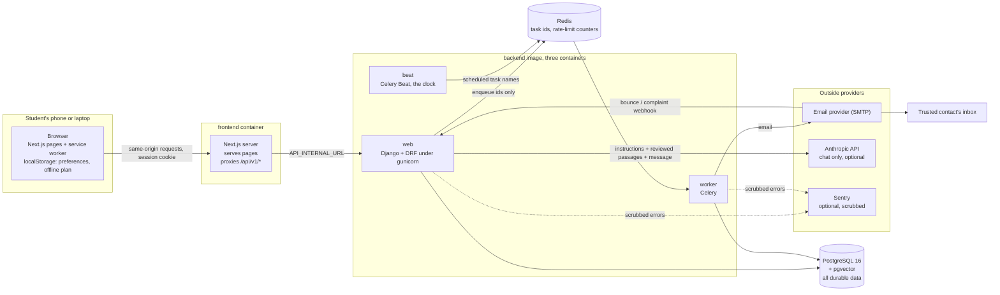

# My guide to this project

A plain-language explanation of how the whole thing works, written for the owner. Every path, function and route named here exists in the repository as of 2026-10-12. Nothing here is a secret, and no example uses a real person.

If you read only three things: section 1 (what it is and is not), section 11 (what still needs a human).

## Contents

1. The big picture
2. How the pieces fit together
3. A tour of the repository
4. The Django apps, one by one
5. Walkthroughs: what happens when...
6. Every table
7. Every endpoint
8. Security and privacy protections, and what each one stops
9. The frontend
10. Background jobs
11. What still needs human review
12. Testing
13. Docker, CI/CD and deployment
14. Running and debugging locally
15. Recipes for common changes
16. Glossary
17. Why each major decision was made

---

## 1. The big picture

The app (working name "Mirrorspace", set by `APP_NAME`) is a self-help tool for students aged 18 and over. A student can:

- do a short daily check-in (mood, sleep, energy, stress), all optional;
- see plain descriptions of their own patterns;
- log difficult episodes and what triggered or helped;
- follow short breathing and grounding exercises;
- write a personal safety plan and see helplines, both available offline;
- choose to send one trusted person a tiny weekly note, or a one-off "I would like to hear from you" message;
- talk to an AI companion that only quotes reviewed material.

### What it deliberately does not do

These are the 8 non-negotiables in `CLAUDE.md`, and tests enforce them.

| It does not | Because |
|---|---|
| Diagnose, treat, or promise to prevent suicide | It is software, not care. Saying otherwise is dangerous and untrue. |
| Share anything by default | Sharing starts off, needs an explicit choice, shows a preview, and can be withdrawn. |
| Alert anyone automatically | No classifier, no score, no "risk flag". A program that guesses will be wrong both ways. |
| Send an SOS on its own | Only the student can, after seeing the exact recipient and the exact text. |
| Claim that anyone is watching, or that a message was delivered | Nobody monitors it. The most it ever says is "queued" or "the provider accepted it". |
| Put sensitive text in logs, task names, queues, Sentry or analytics | Those places are read by operators and third parties. There is no analytics at all. |
| Let one user reach another's data | Every query is filtered by the signed-in user, and every such route has a test that tries to break in. |
| Ship clinical, legal or helpline content as final | All of it is placeholder until a qualified person signs it off. |

It also collects no free-text diary (decision D4), admits no under-18s (D1), and has no admin view of a student's records.

---

## 2. How the pieces fit together



In words:

- **The browser only ever talks to the frontend's own address.** Requests to `/api/v1/...` are forwarded by `frontend/src/app/api/v1/[...path]/route.ts` to the Django API at `API_INTERNAL_URL`. This keeps the session cookie same-origin and simple.
- **Django (the `web` container)** checks who you are, validates input, reads and writes PostgreSQL, and answers in JSON.
- **Anything slow or outbound is a background task.** Django writes a row, then puts only the row's id on the Redis queue (`config/queue.py`, `enqueue_on_commit`). The **worker** picks the id up, re-reads the row, and acts.
- **Beat** is a clock. It puts the names of scheduled tasks on the queue at set times. Exactly one must run.
- **PostgreSQL holds everything that matters.** Redis can be wiped without losing data: pending deletions and notifications live in PostgreSQL and are picked up by sweeper jobs.
- **Email** leaves through one function, `apps/notifications/providers.py` `send_email` (contact messages), or `apps/accounts/emails.py` (account emails).
- **The AI provider** is called from one place, `apps/chat/providers.py`, and only after the safety check and only with reviewed material. Locally it is a mock that never leaves the process.

---

## 3. A tour of the repository

```
CLAUDE.md                 Rules for anyone (or any AI) working on the code
README.md                 Project overview
docs/spec.md              The original build specification
.env.example              Every setting, documented, with safe local values
docker-compose.yml        The local stack: db, redis, web, worker, beat, frontend
Dockerfile.backend        The backend image (one image, three roles)
backend/
  manage.py, conftest.py, pyproject.toml, requirements*.txt, healthcheck.py
  config/                 Project-wide plumbing (settings, URLs, shared base classes)
  apps/                   One folder per feature area
  tests/                  Cross-cutting tests and the shared test harness
frontend/
  Dockerfile, next.config.ts, package.json, playwright.config.ts
  public/sw.js            The service worker (offline support)
  messages/en, messages/hi   All interface wording
  src/app/                Pages
  src/components/         Reusable interface parts, including the pets
  src/lib/                API client, data hooks, schemas, offline copies, preferences
  e2e/                    Browser tests
  tests/copy.test.mjs     Rules the wording must obey
infra/                    Production compose files, deploy, smoke test, load check, restore rehearsal
.github/                  CI, release, deploy and scheduled workflows; Dependabot
docs/                     Everything written down (see the end of this section)
```

### `backend/config/`

| File | What it is for |
|---|---|
| `settings/base.py` | Settings shared everywhere: apps, middleware, DRF, rate limits, the beat schedule, logging. |
| `settings/local.py` | Development. Console email, relaxed cookies. |
| `settings/test.py` | Tests. Tasks run inline, fast hashing. |
| `settings/production.py` | Requires every secret from the environment, forces HTTPS-only cookies, HSTS, and `SHOW_UNREVIEWED_CONTENT` off. |
| `urls.py` | The single list of routes under `/api/v1/`. |
| `views.py` | `OwnedModelViewSet` (the base for anything a user owns) and `CsrfProtectedAPIView` (public writes still need a CSRF token). |
| `api.py` | `SessionAuth` (answers 401 when signed out), `DefaultPagination`, `IPThrottle`, `csrf_failure`. |
| `fields.py` | `EncryptedTextField`, `EncryptedJSONField`, `keyed_hash`. |
| `queue.py` | `enqueue_on_commit`: queue a task only after the database commit, with ids only. |
| `observability.py` | `RedactionFilter`, `JsonFormatter`, `scrub_sentry_event`, `init_sentry`. |
| `middleware.py` | `NoStoreApiMiddleware`: API answers are never cached. |
| `health.py` | `HealthView`, `ReadyView`. |
| `celery.py` | The Celery app. |
| `schema.py` | Tells the OpenAPI generator about session sign-in. |

### `docs/`

| File | Read it when |
|---|---|
| `decisions.md` | You want to know why something is the way it is (D1 to D11 locked, B1 to B62 made while building, Q1 to Q11 still open). |
| `progress.md` | You want the history, phase by phase, with what was not verified. |
| `review-needed.md` | You are arranging sign-offs (R1 to R24 and every safety-critical string). |
| `api.md` | You need exact request and response shapes. |
| `privacy.md` | You need to know what is stored, where, and for how long. |
| `security-review.md` | You want fixed and open security findings. |
| `runbook.md` | You are deploying, rolling back, restoring or handling an incident. |
| `development.md` | You are setting up a machine. |
| `design-plan.md`, `localization.md` | You are working on the interface. |

---

## 4. The Django apps, one by one

Each app in `backend/apps/` has `models.py` (tables), `serializers.py` (input and output shapes), `views.py` (routes), usually `services.py` (the actual rules), `tasks.py` (background jobs) and `tests/`.

### `accounts`
Users and everything about having an account.
- `models.py`: `User` (email is the login; UUID id) and `Profile` (display name, time zone).
- `services.py`: `register_user`, `verify_email`, `request_verification_email`, `request_password_reset`, `reset_password`, `record_failed_login`, `request_account_deletion`, `erase_account`, `purge_stale_accounts`.
- `tokens.py`: signed links (`make_email_verification_token`, `make_password_reset_parts` and their readers).
- `emails.py`: `send_verification`, `send_password_reset`, `send_account_exists`. Templates in `templates/accounts/email/`.
- `export.py`: the export registry. Each app calls `register_export` to add its section; `build_export` assembles the file.
- `throttles.py`: sign-in, registration, email, deletion and export limits.

### `checkins`
- `models.py`: `CheckIn`, one per user per local day (a database constraint).
- `dates.py`: `user_zone`, `local_today`, `earliest_allowed` (7 days back).
- `patterns.py`: `build_patterns` turns check-ins into weekly averages and a few fixed-wording observations. `OBSERVATION_TEMPLATES` is the complete list of things it may say.

### `episodes`
- `Trigger` (a label the student names, encrypted) and `Episode` (when, how intense, how long, what helped, encrypted).

### `wellbeing`
- `Exercise`, `ExerciseTranslation` (title, summary, steps per language), `ExerciseEvent` (started, completed, helpful, not helpful, hidden).
- `ReviewStatus` decides visibility: only `approved` content is shown unless the development switch is on.
- `management/commands/seed_exercises.py` loads placeholder exercises as `needs_review`.

### `safety`
- `SafetyPlan` (one per user; warning signs, coping steps and people are encrypted lists) and `Resource` (a helpline, with `source`, `owner`, `verified_on`, `status`).
- `SafetyPlanView` (get, put, delete) and `ResourceViewSet` (public, read-only).
- Commands: `seed_resources` (unverified placeholders), `flag_stale_resources` (with `--fail-on-stale` for releases).

### `sharing`
The most careful part of the system.
- `models.py`: `TrustedContact`, `SuppressedAddress` (the do-not-email list, fingerprints only), `ConsentRecord`.
- `services.py`: contacts (`add_contact`, `send_invitation`, `resend_invitation`, `accept_invitation`, `decline_invitation`, `unsubscribe`, `mark_bounced`, `remove_contact`) and consent (`record_privacy_notice`, `grant_weekly_consent`, `pause_consent`, `resume_consent`, `reconfirm_consent`, `revoke_consent`, `reschedule_for_user`).
- `weekly.py`: the weekly note. `WeeklyFields` has exactly four fields; `collect_weekly_fields`, `render_weekly`, `weekly_format_hash`.
- `schedule.py`: `next_send_at`, daylight-saving aware.
- `sos.py`: `build_sos_message`, `preview_text`, `request_sos`. The only code that can create an SOS message.
- `tokens.py`: `make_token`, `contact_from_token` for the links a contact receives.
- `notices.py`: the versioned notice texts.

### `notifications`
Sends email to trusted contacts, at most once.
- `Notification`: one row per message, with a unique `idempotency_key` and a status.
- `services.py`: `create_notification`, `blocked_reason` (the send-time consent check), `attempt`, `retry_delay`, `handle_provider_event`, `enqueue_due_weekly`, `sweep_stuck`.
- `render.py`: `render` builds the email and `unsubscribe_footer` adds the link and header.
- `providers.py`: `send_email`, raising `TransientSendError` or `PermanentSendError`.
- `views.py`: `NotificationViewSet` (read-only history) and `EmailWebhookView`.

### `audit`
- `AuditEvent`: who (or a fingerprint), what action, which object, when. Never content.
- `services.py`: `record` (only actions listed in `ACTIONS`, metadata cleaned by `_clean_metadata`), `pseudonymize_user`, `purge_expired`.

### `chat`
- `safety.py`: `normalize` and `assess`. Plain pattern matching, no AI. Returns crisis, distress or nothing.
- `policy.py`: the instructions (`build_system_prompt`), the fixed replies, and `violates_policy` (the output check).
- `knowledge.py`: `chunk`, `embed` (a local, deterministic embedder), `index_document`, `index_all`, `retrieve`.
- `providers.py`: `MockProvider`, `AnthropicProvider`, `get_provider`.
- `services.py`: `generate_reply` (the five steps), `respond`, `set_transcript`, `purge_expired`.
- Models: `ContentDocument`, `ContentChunk`, `ChatSession`, `ChatMessage`, `ChatFeedback`, `ChatUsage`.
- `evaluation/cases.json`: 58 test conversations.
- Commands: `seed_knowledge`, `index_knowledge`.

### `content_admin`
An empty placeholder folder. Content is currently managed through the Django admin.

---

## 5. Walkthroughs: what happens when...

### 5.1 Someone registers

1. `/register` (`frontend/src/app/register/page.tsx`) posts to `POST /api/v1/auth/register`. The API client (`frontend/src/lib/api.ts`, `api`) first fetches a CSRF token from `GET /auth/csrf`.
2. `RegisterView` validates with `RegisterSerializer`: the age box must be ticked, the password must pass `check_password_strength`, the time zone must be real.
3. `register_user` creates the `User` and `Profile` and records `age_confirmed_at`. If the address already has an account, it creates nothing and queues an "you already have an account" email instead.
4. Either way the reply is the same sentence. Nobody can use this route to find out who has an account.
5. The task `send_verification_email` (argument: the user id, nothing else) sends a link. The token sits after the `#` in the link, so it never reaches server logs. `frontend/src/lib/fragment.ts` reads it.
6. `/verify-email` posts the token to `POST /auth/verify-email`; `verify_email` sets `email_verified_at`.
7. Accounts that never verify are removed after 7 days by `purge_stale_accounts`.

### 5.2 Someone signs in

1. `/login` posts to `POST /auth/login`. Limits: 5 a minute per address (`LoginIPThrottle`), 10 an hour per account (`LoginEmailThrottle`).
2. Wrong password, unknown email and locked account all give the same `invalid_credentials`. A correct password on an unverified account gives `email_not_verified`.
3. On success Django creates a server-side session and sets an `HttpOnly` cookie. JavaScript cannot read it.
4. The frontend's `useMe` hook (`src/lib/hooks.ts`) calls `GET /auth/me`. `AppShell.tsx` uses the answer to decide between the app, the onboarding screen, or the sign-in page.
5. If the request fails because there is no connection (`ApiError.status === 0`), `AppShell` switches to an offline mode so the saved safety plan still opens.

### 5.3 A check-in

1. `(app)/check-in/page.tsx` shows five optional controls and posts whatever was chosen to `POST /check-ins`.
2. `CheckInSerializer` insists on at least one value, a date no later than today and no earlier than 7 days ago (in the student's own time zone, from `dates.py`).
3. `CheckInViewSet.create` saves it. If that day already has a check-in it is replaced and the answer is `200` instead of `201`.
4. The owner is taken from the session by `OwnedModelViewSet.perform_create`. A `user` field in the request is ignored.

### 5.4 Patterns

1. `(app)/patterns/page.tsx` calls `GET /patterns?days=28`.
2. `build_patterns` loads only that user's check-ins, computes weekly averages (`_weekly`) and, if there is enough data, a comparison such as mood on longer-sleep and shorter-sleep days (`_sleep_comparison`).
3. Observations come back as a code plus numbers. The wording lives in the frontend messages and is checked against a banned-phrase list in both backend and frontend tests. It describes; it never explains or advises.
4. `TrendChart.tsx` draws the chart and also provides the same data as a table for screen readers.

### 5.5 The weekly email, start to finish

**Adding the contact**
1. On `(app)/sharing/page.tsx` the student enters a name and email. `POST /trusted-contacts` calls `add_contact` (limit 10 a day).
2. The name, email and relationship are encrypted. A fingerprint (`email_fingerprint`) is stored for duplicate and do-not-email checks.
3. `send_invitation` creates a `Notification` of purpose `contact_invitation`. The contact gets an email saying who invited them and what they might receive.
4. The contact opens `/contact-invitation`, which calls `POST /contact-invitations/view` and then `accept` or `decline`. Until they accept, nothing else can be sent to them. This is the double opt-in.

**Turning the note on**
5. `WeeklySetup.tsx` calls `GET /sharing/preview?contact=<id>`. `WeeklyPreviewView` returns the exact subject and body, the four fields shared, the notice text, the `notice_version` and a `preview_hash`.
6. The student ticks a confirmation and submits. `POST /sharing/consent` calls `grant_weekly_consent`, which refuses unless: the contact is theirs and confirmed, the notice version is current, the hash matches the current wording, and `confirmed` is exactly `true`.
7. A `ConsentRecord` is created with `next_send_at` from `schedule.next_send_at`. Nothing is emailed yet.

**Each week**
8. Every 10 minutes beat runs `notifications.enqueue_due_weekly`. For each active consent that is due it locks the row, pauses it if it has not been reconfirmed in 90 days, and otherwise creates a `Notification` with the key `weekly:<consent id>:<last day of the week>`. That key is unique in the database, so a week can produce only one note however often the job runs.
9. The worker runs `notifications.deliver` with the notification id, which calls `attempt`.
10. `attempt` locks the row and calls `blocked_reason`. This is the **send-time consent check**: is the consent still active, the contact still confirmed, the address not suppressed, the account still open? If anything changed since step 8, the note is cancelled with a reason code.
11. `render` builds the text from `collect_weekly_fields` at that moment: display name, week start, week end, number of days checked in. No mood, no scores, no episodes.
12. The status is set to `sending` and **committed before** the provider is called. If the same task is delivered twice, the second sees `sending` and stops.
13. `send_email` hands the message over. Success sets `sent`. A temporary failure schedules a retry (`retry_delay`), up to 5 attempts. A permanent rejection marks the contact `bounced` and withdraws consent.
14. If a worker dies between steps 12 and 13, `sweep_stuck` later marks the note `failed` with `outcome_unknown`. It is not sent again.

**Stopping**
15. The student can pause, resume or withdraw (`DELETE /sharing/consent/{id}`) at any time. The contact can unsubscribe from the link in every email (`POST /unsubscribe`) or their mail app's one-click button (`POST /unsubscribe/one-click`). The consent row is kept as history, marked revoked.

### 5.6 The SOS flow

1. The Support screen (`frontend/src/app/support/page.tsx`) is reachable from every screen through the `SupportLink` in `AppShell.tsx`, and works signed out and offline (helplines and the saved plan).
2. A signed-in student with a confirmed contact chooses that contact. `POST /sos/preview` (`SosPreviewView`) returns the exact recipient, subject, body and a `message_hash` from `build_sos_message`. Nothing is recorded.
3. The student reads it and confirms. The browser generates a random `idempotency_key` and posts to `POST /sos/notify-contact` with `confirmed: true`.
4. `request_sos` checks: the contact is theirs, is confirmed, the hash still matches what would be sent, the key has not been used (a double tap returns the first message), and fewer than 6 were sent in 24 hours. `SosThrottle` adds 3 an hour.
5. A `Notification` is created holding the approved text, encrypted. The reply says "queued to send" and that the app cannot tell whether it was read. It never says "sent".
6. Delivery is the same `attempt` path as above, with the same last-moment checks. Once the outcome is final the stored text is wiped (`_finish`).
7. The student can follow the status under Sharing, History (`GET /notifications/{id}`).

The text is fixed and cannot be edited (decision B29). No other code path can create an SOS: a test scans the codebase for it.

### 5.7 A chat message

`POST /chat/sessions/{id}/messages` reaches `ChatSessionViewSet.messages`, then `services.respond`, then `generate_reply`:

1. **Safety, in code.** `safety.assess` normalizes the text (case, spacing, common misspellings, Hindi and Hinglish phrases) and matches it against fixed patterns. A match returns a fixed, human-written reply with routes to Support, the safety plan and helplines. The model is not asked. Nobody is notified. This happens before any limit or provider check, so it works even when the budget is spent or the provider is down.
2. **Budget.** `_budget_left` checks the per-student and global daily limits (`ChatUsage`).
3. **Reviewed material.** `retrieve` finds approved passages that share at least two meaningful terms with the question. If there are none, the reply is fixed text ("no reviewed material") and no model is called.
4. **The provider.** `get_provider().complete(...)` receives the instructions, up to three passages, the message and at most six earlier turns. Never a name, email, id or any record.
5. **Check the answer.** `safety.assess` runs again on the reply, then `policy.violates_policy` looks for diagnoses, medication advice, monitoring claims and leaked instructions. A failing reply is thrown away and fixed text shown.

Transcripts: by default nothing is written to the database and the browser holds the conversation. If the student turns saving on (`set_transcript`), messages are stored encrypted for at most 30 days; turning it off deletes them.

### 5.8 Export and deletion

**Export.** `GET /export` calls `build_export`, which walks the registry and returns one JSON file. `tests/test_data_coverage.py` inspects every model that points at a user and fails if one is missing from the export.

**Deletion.**
1. Settings asks for the password. `DELETE /account` calls `request_account_deletion`: the account is deactivated at once (all sessions stop), `deletion_requested_at` is set, and the task `erase_account` is queued with the user id.
2. `erase_account` locks the user, calls `pseudonymize_user` (audit events are detached and stamped with a one-way fingerprint), records `account.erased`, and deletes the user. Every owned row goes with it by database cascade.
3. If the task is lost, the hourly `purge_stale_accounts` finishes the job.
4. What survives: pseudonymous audit events for 12 months, and do-not-email fingerprints. The same coverage test proves that only `AuditEvent` survives.
5. The browser also clears its offline copies (`clearOfflineCopies`).

---

## 6. Every table

Table names follow Django's default: `<app>_<model>` in lower case. All ids are UUIDs unless noted. "Encrypted" means stored through `EncryptedTextField` or `EncryptedJSONField`.

| Table | Holds | Notes |
|---|---|---|
| `accounts_user` | `email`, password hash, `preferred_language`, `is_active`, `is_staff`, `age_confirmed_at`, `email_verified_at`, `deletion_requested_at`, `created_at` | Email unique ignoring case. Passwords hashed with Argon2. |
| `accounts_profile` | `display_name`, `timezone` | One per user. |
| `checkins_checkin` | `local_date`, `timezone`, `mood`, `sleep_hours`, `sleep_quality`, `energy`, `stress` | One per user per day. Range checks in the database. No free text. |
| `episodes_trigger` | `label` (encrypted), `is_active`, preferred exercises | |
| `episodes_episode` | `occurred_at`, `intensity`, `duration_minutes`, trigger, exercise that helped, `what_helped` (encrypted) | |
| `wellbeing_exercise` | `slug`, `category`, `duration_minutes`, `pattern`, `review_status`, `version`, `reviewed_on`, `reviewed_by` | Shared content, not user data. |
| `wellbeing_exercisetranslation` | `language`, `title`, `summary`, `steps`, review fields | One per exercise per language. |
| `wellbeing_exerciseevent` | exercise, `kind` | The student's own history with an exercise. |
| `safety_resource` | `slug`, `name`, `type`, `region`, `languages`, `phone`, `url`, `hours`, `source`, `owner`, `verified_on`, `status`, `flagged_stale_at` | Helplines. Shared content. |
| `safety_safetyplan` | `warning_signs`, `coping_steps`, `people` (all encrypted), chosen resources | One per user. |
| `sharing_trustedcontact` | `name`, `email`, `relationship` (all encrypted), `email_hash`, `status`, `invite_count`, `invited_at`, `responded_at` | |
| `sharing_suppressedaddress` | `email_hash`, `reason` | No address, only a fingerprint. Not tied to a user. Kept indefinitely. |
| `sharing_consentrecord` | `purpose`, contact, `scope`, `notice_version`, `status`, `status_reason`, timestamps, `send_weekday`, `send_hour`, `next_send_at` | Never deleted while the account exists. Database rules: one live consent per contact and purpose; only an active consent may have a send time. |
| `notifications_notification` | `purpose`, contact, consent, `idempotency_key` (unique), `status`, `status_code`, `retry_count`, `provider_reference`, `context`, `body` (encrypted, wiped when final), timestamps | |
| `audit_auditevent` | `actor` or `actor_hash`, `action`, `object_type`, `object_id`, `metadata`, `created_at` | The only user-linked table that outlives deletion, pseudonymized. Purged at 12 months. |
| `chat_contentdocument` | `slug`, `title`, `source`, `audience`, `language`, `body`, review fields, `version` | The knowledge base. Shared content. |
| `chat_contentchunk` | document, `position`, `text`, embedding vector | Built by `index_knowledge`. |
| `chat_chatsession` | `save_transcript` (default false), `retention_days`, `expires_at` | |
| `chat_chatmessage` | session, `role`, `kind`, `content` (encrypted), `sources` | Exists only if saving is on. |
| `chat_chatfeedback` | session, `kind`, `helpful` | A rating, no text. |
| `chat_chatusage` | user, `day`, `replies` | Daily counter for the budget. Integer id. |

Django's own tables (sessions, admin log, migrations, permissions) also exist.

---

## 7. Every endpoint

All under `/api/v1`. "Public" means no sign-in needed. Everything else needs a session and only ever returns the caller's own rows. Exact shapes are in `docs/api.md`.

### Platform
| Route | Purpose |
|---|---|
| `GET /health` (public) | Is the process alive? |
| `GET /ready` (public) | Are the database and Redis reachable? |
| `GET /schema` | OpenAPI description. Staff only in production. |

### Accounts
| Route | Purpose |
|---|---|
| `GET /auth/csrf` (public) | Get the CSRF token. |
| `POST /auth/register` (public) | Create an account. |
| `POST /auth/verify-email` (public) | Confirm the email. |
| `POST /auth/resend-verification` (public) | Send the link again. |
| `POST /auth/login` (public) | Sign in. |
| `POST /auth/logout` | Sign out. |
| `GET`, `PATCH /auth/me` | Read or change language, display name, time zone. |
| `POST /auth/password-reset` (public) | Ask for a reset link. |
| `POST /auth/password-reset/confirm` (public) | Set a new password. |
| `DELETE /account` | Delete the account (needs the password). |
| `GET /export` | Download everything. |

### Daily use
| Route | Purpose |
|---|---|
| `GET`, `POST /check-ins`; `GET`, `PUT`, `PATCH`, `DELETE /check-ins/{id}` | Check-ins. |
| `GET /patterns` | Summaries of the caller's check-ins. |
| `GET`, `POST /triggers`; `GET`, `PUT`, `PATCH`, `DELETE /triggers/{id}` | Triggers. |
| `GET`, `POST /episodes`; `GET`, `PUT`, `PATCH`, `DELETE /episodes/{id}` | Episodes. |
| `GET /exercises`, `GET /exercises/{id}` | Exercises in the caller's language. |
| `GET`, `POST /exercise-events`; `GET`, `DELETE /exercise-events/{id}` | Started, completed, helpful, hidden. |
| `GET`, `PUT`, `DELETE /safety-plan` | The safety plan. |
| `GET /resources`, `GET /resources/{id}` (public) | Helplines. |

### Sharing and Support
| Route | Purpose |
|---|---|
| `GET`, `POST /trusted-contacts`; `GET`, `PATCH`, `DELETE /trusted-contacts/{id}` | Contacts. The email cannot be changed after creation. |
| `POST /trusted-contacts/{id}/resend-invitation` | At most 3 invitations, 24 hours apart. |
| `POST /contact-invitations/view`, `/accept`, `/decline` (public, token) | What the contact does. |
| `POST /unsubscribe` (public, token) | Contact stops messages. |
| `POST /unsubscribe/one-click` (public, token) | The mail app's unsubscribe button. |
| `GET /sharing/notices` (public) | Current notice versions and text. |
| `GET /sharing/preview?contact={id}` | The exact weekly note. |
| `GET`, `POST /sharing/consent`; `GET`, `DELETE /sharing/consent/{id}` | Consent and its history. |
| `POST /sharing/consent/{id}/pause`, `/resume`, `/confirm` | Control the schedule. |
| `POST /sos/preview` | The exact SOS recipient and text. |
| `POST /sos/notify-contact` | Send it. |
| `GET /notifications`, `GET /notifications/{id}` | What was sent and what happened. |
| `POST /webhooks/email-events` (shared secret) | Bounces and complaints from the email provider. |

### Chat
| Route | Purpose |
|---|---|
| `GET /chat/info` (public) | What the chat is and is not. |
| `GET`, `POST /chat/sessions`; `GET`, `PATCH`, `DELETE /chat/sessions/{id}` | Conversations and the saving switch. |
| `POST /chat/sessions/{id}/messages` | Send a message. |
| `GET`, `POST /chat/feedback`; `GET`, `DELETE /chat/feedback/{id}` | Helpful or not. |

`backend/tests/test_routes.py` holds the reviewed list of public routes. Adding a route that is neither on that list nor covered by an ownership test fails the build.

---

## 8. Security and privacy protections, and what each one stops

| Protection | Where | What it stops |
|---|---|---|
| Ownership filter | `OwnedModelViewSet.get_queryset` in `config/views.py` | One student reading or changing another's rows. Someone else's id answers 404, the same as a made-up id. |
| Owner from the session | `OwnedModelViewSet.perform_create` | Creating a row in someone else's name by putting their id in the request. |
| Session cookie, `HttpOnly` | settings | Injected script stealing the login. |
| CSRF token on every write, including anonymous ones | `CsrfProtectedAPIView`, `config/api.py` `csrf_failure` | Another website making your browser act for you. |
| Same-origin proxy | `frontend/src/app/api/v1/[...path]/route.ts` | Cross-site cookie complications; the API is not called directly by browsers. |
| Identical replies | `RegisterView`, `LoginView`, password reset | Discovering who has an account. |
| Rate limits | `DEFAULT_THROTTLE_RATES` in `settings/base.py`, the throttle classes | Password guessing, invitation spam, SOS flooding, chat cost abuse. |
| Argon2 hashing, strength rules | `PASSWORD_HASHERS`, `check_password_strength` | Stolen database yielding passwords; trivially weak passwords. |
| Links in the URL fragment | `frontend/src/lib/fragment.ts`, email templates | Tokens appearing in server logs, proxies or referrer headers. |
| Field encryption | `config/fields.py` | A stolen database dump revealing triggers, plans, contacts or chats. Needs `FIELD_ENCRYPTION_KEYS` to read. |
| Keyed fingerprints | `keyed_hash` | Keeping a do-not-email list and audit trail without storing addresses or identities. |
| Log redaction | `RedactionFilter`, `JsonFormatter` | Emails, tokens or free text reaching logs even by mistake. |
| Sentry scrubbing | `scrub_sentry_event`, `drop_breadcrumb` | Request bodies, cookies, headers, user details and local variables leaving for a third party. |
| Ids-only tasks | `enqueue_on_commit` | Sensitive text sitting in Redis or in task names. |
| No-store API | `NoStoreApiMiddleware`; `public/sw.js` skips `/api/` | Records left in a cache on a shared device. |
| Double opt-in | `accept_invitation` | Using the app to email someone who never agreed. |
| Do-not-email list | `SuppressedAddress`, `is_suppressed` | Emailing someone who said stop, even via a different student. |
| Preview hash | `weekly_format_hash`, `build_sos_message` | Sending wording the student did not see. |
| Send-time check | `blocked_reason` in `attempt` | A note going out after consent was withdrawn. |
| Idempotency keys, `sending` state | `Notification.idempotency_key`, `attempt` | Duplicate emails. |
| Four-field weekly note | `WeeklyFields` | Mood or health details leaking into the note. |
| Review status gate | `ReviewStatus`, production settings | Unreviewed exercises, helplines or knowledge reaching students. |
| Safety check before and after the model | `safety.assess`, `violates_policy` | The AI handling a crisis, diagnosing, or claiming to monitor. |
| Minimal provider context | `generate_reply`, `_clean_history` | Identity or records reaching the AI provider. |
| Audit allow-list | `ACTIONS`, `_clean_metadata` in `apps/audit/services.py` | Content creeping into the audit trail. |
| Required secrets, locked production settings | `settings/production.py` | Starting production with debug on or a default key. |
| Response headers and a partial content policy | `frontend/next.config.ts` | Framing and some injection routes. Inline scripts are still allowed (open finding S3). |
| Non-root containers | both Dockerfiles | A compromised process having root in its container. |

Not yet in place: multi-factor sign-in for the admin, edge rate limiting, a strict script policy, an independent security test. See `docs/security-review.md`.

---

## 9. The frontend

### Structure

- `src/app/layout.tsx`: the root. Loads fonts and messages, and runs `PREFS_BOOT_SCRIPT` so the theme is right before the first paint.
- Public pages: `/` (landing), `/resources`, `/support`, `/login`, `/register`, `/verify-email`, `/forgot-password`, `/reset-password`, `/contact-invitation`, `/unsubscribe`, `/offline`.
- `src/app/(app)/`: signed-in pages wrapped by `AppShell.tsx`: `home`, `onboarding`, `check-in`, `patterns`, `episodes`, `exercises`, `exercises/[id]`, `plan`, `sharing`, `sharing/history`, `settings`, `more`, `chat`.
- `src/lib/api.ts`: one function, `api`, for every request. It adds the CSRF header, validates the answer against a Zod schema, and throws `ApiError`.
- `src/lib/schemas.ts`: the expected shape of every response. If the API changes shape, the page fails loudly rather than showing wrong data.
- `src/lib/hooks.ts`: shared data hooks (`useMe`, `useConsents`, `useNotices`, `useExercises`, `useResources`, `useSafetyPlan`) plus `useErrorText`, `localDate`, `browserTimeZone`.
- `src/lib/offline.ts`: copies of the safety plan, helplines and exercises in `localStorage`, with `clearOfflineCopies`. `ALLOWED_STORAGE_KEYS` is the full list of what may be stored on the device.
- `src/lib/prefs.ts`: theme, reduced motion, low-data mode and text size, on the device only.
- `public/sw.js`: caches the app shell and the Support page; never caches `/api/`.
- `messages/en/*.json`: all wording. `messages/hi/` is partial and unreviewed. The language is a cookie, not part of the URL (`src/i18n/request.ts`).

### The design system ("Aurora")

Defined as CSS variables in `src/app/globals.css` and described in `docs/design-plan.md` (latest revision: "Aurora"). Two themes, `night` (default) and `daybreak`. Content sits on frosted-glass panels (`.frame`, `.glass`) with rounded, pill-shaped controls. Building blocks:

- `components/ui/primitives.tsx`: `Button`, `IconButton`, `Panel`, `GlassPanel`, `Field`, `ProgressRing`, `Notice`, `UnreviewedBadge`, `SkipLink`, `VisuallyHidden`.
- `components/ui/controls.tsx`: `Slider`, `Toggle`, `ScaleControl`, `Dialog`, `Tabs`, `ToastProvider` and `useToast`, built on Radix for keyboard and screen-reader behaviour.
- Feature components: `pet/Pet`, `pet/PawWeek`, `AuroraBackground`, `WeeklySetup`, `BreathingPlayer`, `TrendChart`, `ResourceList`, `PreferenceControls`, `ThemeToggle`, `AuthPage`, `PublicHeader`, `landing/Story`, `landing/HelplineStrip`.

Every screen is checked with axe in the browser tests, at 320 px width and with larger text.

### The aurora

Every page sits on a slow-breathing gradient. `src/app/globals.css` paints a still version on `<body>` (the `--aurora` colours), and `components/AuroraBackground.tsx` fades `components/ui/animated-gradient-background.tsx` in on top so it breathes. It stays still on Support and the offline page, with reduced motion, and in low-data mode. If you change the colours, change them in both places.

### The pets

`components/pet/Pet.tsx` draws three pets seen from behind (cat, bunny, fox) as plain SVG; their movements are CSS in `globals.css` under "Pets". A pet takes a `mood` (listening, heavy, storm, racing, lighter, steady, alone), an optional `breathPhase` for guided breathing, and a `label` saying what it shows. `components/pet/PawWeek.tsx` draws the week on Home as paw prints. Nothing is downloaded and nothing about a person is stored to drive them: the check-in pet follows the slider on screen, and the Vent cat follows the reaction the server returns. Support deliberately has no pet.

---

## 10. Background jobs

Queued on demand (each takes ids only):

| Task | Triggered by |
|---|---|
| `send_verification_email`, `send_password_reset_email`, `send_account_exists_email` (`apps/accounts/tasks.py`) | Registration and password reset |
| `erase_account` | Account deletion |
| `deliver` (`apps/notifications/tasks.py`) | Any new notification: invitation, weekly note, SOS |

Scheduled (`CELERY_BEAT_SCHEDULE` in `backend/config/settings/base.py`):

| Task | When | What |
|---|---|---|
| `notifications.enqueue_due_weekly` | Every 10 minutes | Plans due weekly notes. |
| `notifications.sweep_stuck` | Every 10 minutes, offset by 5 | Marks unfinished sends as failed. Never re-sends. |
| `accounts.purge_stale_accounts` | Hourly at :17 | Finishes lost deletions; removes accounts unverified after 7 days. |
| `chat.purge_expired` | Hourly at :37 | Deletes saved chats past their date. |
| `accounts.clear_expired_sessions` | Daily 03:41 | Removes expired sessions. |
| `audit.purge_expired` | Daily 04:13 | Removes audit events older than 12 months. |

---

## 11. What still needs human review

Nothing below has been signed off. The full list with locations is `docs/review-needed.md` (R1 to R24 plus a generated checklist of every string on the safety-critical screens). 39 files carry a `NEEDS_HUMAN_REVIEW` marker.

| Who | What |
|---|---|
| A mental-health professional | Every exercise; the pattern observation wording and thresholds; the check-in scale wording; the chat instructions, knowledge documents and evaluation answers. |
| A safeguarding professional | The crisis phrase list in `apps/chat/safety.py` and the fixed replies in `policy.py`; the SOS screen and message; the weekly-note wording; who responds if a student reports danger to the team. |
| An India-qualified privacy lawyer | The privacy and consent notices (`apps/sharing/notices.py`); the 18+ policy; retention periods, including backups and the indefinite do-not-email list; a notice for trusted contacts; the AI provider's data terms; the breach procedure. |
| A named helpline owner | Every entry in `safety_resource`. Both seeded entries are unverified, so production shows none. Nobody is assigned yet. |
| Fluent speakers | Hindi, and any later language. |
| A security reviewer | Key handling, and an independent test. |

Also unproven because it has never been tried: a real email provider, a real AI model, a real hosting environment, the GitHub workflows, and real phones with real screen readers.

---

## 12. Testing

**Backend** (`pytest`, 766 tests, 98% coverage, on real PostgreSQL):

- `backend/tests/harness.py`: `OwnedResourceContract` and `SingletonResourceContract`. A test class inherits one, names a route and a factory, and automatically gets the full set of break-in attempts: list, read, change, delete and create-as-someone-else, plus signed-out access.
- `tests/test_harness.py`: proves the contract fails against a deliberately leaky endpoint.
- `tests/test_routes.py`: every route is public-and-reviewed or ownership-tested.
- `tests/test_data_coverage.py`: every user-linked model is in the export and gone after deletion.
- `tests/test_hardening.py`, `tests/test_observability.py`: production settings, secrets, canary strings in logs, tasks and Sentry.
- Per app: `apps/<app>/tests/`. The ones to read first are `sharing/tests/test_consent.py`, `sharing/tests/test_sos.py`, `sharing/tests/test_weekly_message.py`, `notifications/tests/test_delivery.py` and `chat/tests/test_chat.py`.
- `backend/conftest.py`: shared fixtures (a frozen clock, signed-in clients, tasks that run immediately).

**Frontend:**

- `frontend/e2e/*.spec.ts` (66 Playwright tests): drive a real browser against the production build and the real API, with an axe accessibility scan on each screen. `e2e/helpers.ts` creates accounts and reads emails from the backend.
- `frontend/tests/copy.test.mjs`: wording rules, such as never claiming monitoring.
- `npm run lint`, `npm run typecheck`.

---

## 13. Docker, CI/CD and deployment

**Images.** `Dockerfile.backend` builds one image used as `web` (gunicorn), `worker` and `beat`. `frontend/Dockerfile` builds the Next.js standalone server. Both use pinned base images, run as a non-root user, and have health checks.

**Local.** `docker-compose.yml` starts `db`, `redis`, `web`, `worker`, `beat` and `frontend` using `.env.example`. Ports are bound to `127.0.0.1` only.

**Workflows** in `.github/workflows/` (written, never run, because the repository has no remote yet):

| File | Does |
|---|---|
| `ci.yml` | On every pull request and push: backend tests, lint, types, migration check; frontend lint, types, copy tests, build, browser tests. |
| `release.yml` | On `main`: builds both images, scans them, audits dependencies, publishes to GitHub Container Registry tagged `sha-<commit>`. No `latest`. |
| `deploy.yml` | Manual: you choose an environment and a commit. Production needs approval. |
| `scheduled.yml` | Weekly dependency audit; reminder issues for helpline verification and the restore rehearsal. |

**Deploying** (`infra/deploy.sh`): pull the images for one commit, run migrations with the new image while the old one serves, replace the containers, run `infra/smoke-test.sh`. Rolling back is deploying the previous commit. Full procedures, secrets, backups and incidents are in `docs/runbook.md`.

**Other tools:** `infra/docker-compose.production.yml`, `infra/docker-compose.staging-local.yml` (rehearse production on one machine), `infra/loadcheck.py`, `infra/backup-restore-rehearsal.sh`.

---

## 14. Running and debugging locally

Start everything:

```bash
docker compose up -d --wait
```

The app is at http://localhost:3000 and the API at http://localhost:8000/api/v1/health.

Load placeholder content (shown with an "unreviewed" badge locally):

```bash
docker compose exec web python manage.py seed_exercises
```

```bash
docker compose exec web python manage.py seed_resources
```

```bash
docker compose exec web python manage.py seed_knowledge
```

```bash
docker compose exec web python manage.py index_knowledge
```

Read emails: every email the app sends locally lands in the Mailpit inbox at http://localhost:8025. Nothing reaches a real address. To deliver for real, put your provider's SMTP settings in `.env` (see the email section of `.env.example`), restart, and check them with:

```bash
docker compose exec web python manage.py send_test_email you@example.com
```

Run the backend tests. The test tools are not in the container image, so this runs on your machine from `backend/`, with the database container up and a virtual environment set up as in `docs/development.md`:

```bash
.venv/Scripts/python -m pytest
```

Run the browser tests, from `frontend/`, after `npm run build`:

```bash
npm run e2e
```

Make an admin user:

```bash
docker compose exec web python manage.py createsuperuser
```

### When something looks wrong

| Symptom | Look at |
|---|---|
| Hundreds of tests error at once | The database is not running. `docker compose up -d --wait db redis`. |
| A request returns 403 | Missing CSRF token. The frontend's `api` handles it; a hand-made request needs `X-CSRFToken`. |
| A request returns 404 for a row you can see in the admin | It belongs to another user. That is the ownership filter working. |
| An email never arrives | `docker compose logs worker`. Look for `notification_cancelled` and its `reason`, or `notification_failed`. Then the row's `status_code`. |
| A weekly note did not go | Is the consent `active` with a `next_send_at` in the past? Is beat running? Is the contact still `confirmed`? |
| Exercises or helplines are missing | Their status is not `approved` and `SHOW_UNREVIEWED_CONTENT` is off. |
| Chat always says "no reviewed material" | Run `index_knowledge`; the documents must be approved, or the development switch on. The question must share at least two meaningful words with a passage. |
| A page shows old content | The service worker. Unregister it in the browser's developer tools, or reload twice. |
| Logs show `[redacted]` | The redaction filter removed something that looked like an email or token. Log an id instead. |

Logs are one JSON object per line: an event name and ids. Search by `notification_id` or `user_id`.

---

## 15. Recipes for common changes

**Change any wording.** Edit `frontend/messages/en/<area>.json`. Run `npm run test:unit`. If it is on Support, the plan, helplines, sharing or the contact pages, run `node scripts/string-checklist.mjs` so `docs/review-needed.md` is regenerated, and get it reviewed.

**Change the weekly note or SOS text.** Edit the templates in `apps/sharing/weekly.py` or `apps/sharing/sos.py` and bump `WEEKLY_NOTICE_VERSION` or `SOS_TEMPLATE_VERSION` in `apps/sharing/notices.py`. The hash changes, so anyone mid-preview must look again. Update `test_weekly_message.py`, which compares the text character for character. Needs safeguarding review.

**Change a consent or privacy notice.** Edit `apps/sharing/notices.py` and give it a new version. Existing consents keep the version they agreed to; resuming a paused one requires the new notice. Needs legal review.

**Approve an exercise, helpline or knowledge document.** In the admin, the reviewer sets the status to `approved` and fills in who and when. For knowledge, then run `index_knowledge`. Code never approves anything.

**Add or correct a helpline.** In the admin: fill `source`, `owner`, `verified_on`, then approve. To pull a wrong number immediately, set it to `retired`.

**Add a field to the check-in.** Add it to `CheckIn` with a database range check, run `makemigrations`, add it to `CheckInSerializer`, the export section, `checkInSchema` in the frontend, and the form. Never add free text without revisiting decision D4.

**Add a new kind of user data.** Create the model with a `user` foreign key (cascade). Make the viewset inherit `OwnedModelViewSet`. Add a test class inheriting `OwnedResourceContract`. Call `register_export`. The route and data-coverage tests will fail until you have done all of it, which is the point.

**Add a public route.** Add it to `PUBLIC_ROUTES` in `tests/test_routes.py` with a reason. Use `CsrfProtectedAPIView` if it accepts writes, and add a throttle.

**Add a language.** Copy `frontend/messages/en/` to a new folder, translate, add the code to `LANGUAGES` in settings and the frontend's locale list, add `ExerciseTranslation` rows. Have a fluent speaker review before release (`docs/localization.md`).

**Change a rate limit.** `DEFAULT_THROTTLE_RATES` in `settings/base.py`; SOS and chat daily limits are environment variables in `.env.example`.

**Switch the chat to the real model.** Set `CHAT_PROVIDER=apps.chat.providers.AnthropicProvider` and provide `ANTHROPIC_API_KEY` through the secret store. Do the evaluation and clinical review first (R24).

**Turn the chat off.** Set `CHAT_PROVIDER` back to the mock and remove the Chat entry from `frontend/src/app/(app)/more/page.tsx`.

**Add a scheduled job.** Write the task with no sensitive arguments, add it to `CELERY_BEAT_SCHEDULE`, and to the table in `docs/runbook.md`.

---

## 16. Glossary

| Term | Meaning |
|---|---|
| API | The set of web addresses the frontend calls to read and save data. |
| Beat | Celery's clock. Starts scheduled jobs. |
| Canary string | A made-up marker placed in test data; tests then search logs and queues to prove it never appears. |
| Cascade | A database rule: delete the user and the rows that belong to them go too. |
| Celery | The system that runs background jobs. |
| Consent record | A stored fact that a student agreed to a specific thing, with the notice version they saw. |
| CSRF | A trick where another site makes your browser send a request. The CSRF token defeats it. |
| Double opt-in | The contact must agree before receiving anything further. |
| DRF | Django REST Framework, the toolkit the API is built with. |
| Embedding | A list of numbers representing a piece of text, used to find similar passages. Here it is computed locally. |
| Fernet | The encryption scheme used for sensitive fields. |
| Fingerprint, keyed hash | A one-way code computed from a value plus a secret. You can check a match but cannot recover the value. |
| GHCR | GitHub Container Registry, where images are published. |
| Idempotency key | A unique label on a request so that repeating it has no extra effect. |
| Pets | The animated cat, bunny and fox drawn in SVG (`components/pet`). They replaced the earlier particle "Lumen". |
| Migration | A recorded change to the database structure. |
| pgvector | A PostgreSQL extension for storing and comparing embeddings. |
| Pseudonymize | Replace an identity with a fingerprint so events can be kept without naming anyone. |
| PWA | A website that can be installed and can work offline. |
| Service worker | The browser script that makes offline use possible. |
| Session | The server's record that a browser is signed in, linked by a cookie. |
| Smoke test | A handful of quick checks run right after a deploy. |
| SOS | The message a student chooses to send to a trusted contact from the Support screen. |
| Throttle | A rate limit. |
| Trusted contact | One person the student names who has agreed to receive messages. |
| Worker | The process that carries out background jobs. |

---

## 17. Why each major decision was made

The full record is `docs/decisions.md`. The ones that shape the product:

| Decision | Why |
|---|---|
| **D1: adults only** | Children's data under India's rules may need verified guardian consent. Excluding minors avoids getting that wrong before a lawyer has looked. |
| **D2: session cookies, not tokens in the browser** | A cookie that script cannot read survives an injection attack; a token in `localStorage` does not. |
| **D3: the weekly note says almost nothing** | It shows the student is using the tool, not how they feel. A contact cannot read a mood into it, and "silence means nothing" is stated in the note. |
| **D4: no free-text notes** | The most sensitive data is the data you never collect. |
| **D5: delete everything, keep a pseudonymous audit trail for 12 months** | Honours deletion while keeping proof that consent was given and withdrawn. |
| **D6: double opt-in, unsubscribe everywhere, rate limits** | Stops the app being used to send unwanted email to someone who never agreed. |
| **D7: safety plan and helplines work offline** | The moment someone needs them is often the moment the connection is bad. |
| **D8: no automated risk detection** | A classifier is wrong in both directions. A false alarm breaks trust and privacy; a miss creates false reassurance. The student stays in control. |
| **D9: core first, chat later** | The safety boundaries had to work before an AI feature sat on top of them. Whether chat ships in the first release is still your call. |
| **D10: free text goes nowhere except, for chat, the AI provider** | Every extra recipient is another place it can leak or be kept. |
| **D11: English first, translations reviewed by fluent speakers** | Mistranslated wellbeing wording can mislead or harm. |
| **Field encryption (B-series)** | A database leak alone should not expose triggers, plans, contacts or chats. |
| **At-most-once sending (B62)** | A duplicate note or SOS to a contact is worse than a visible "could not confirm" the student can act on. |
| **Fixed SOS text (B29)** | An editable message could carry anything, and what was previewed must be what is sent. |
| **No reviewed material, no model call (B50)** | An ungrounded model is the riskier path. It also costs nothing. |
| **The model's reply is not trusted (B55)** | Prompt injection and model error are handled the same way: by not showing the output. |
| **Local embeddings (B53)** | No extra company receives student text. The cost is that it matches words, not meaning. |
| **Same-origin proxy, hand-written service worker, no animation library** | Fewer moving parts and smaller downloads on low-end phones. |
| **Images tagged by commit only (B59); migrate first (B60); generic host (B61)** | A deploy and a rollback each point at exactly one build; no downtime; no commitment to a host that has not been chosen. |
| **API answers never cached (B57)** | A borrowed phone must not hold someone's records. |

Open questions you still own (Q1 to Q11) include: the product's real name, which host, which email provider, who owns the helplines, and whether chat is in the first release.
